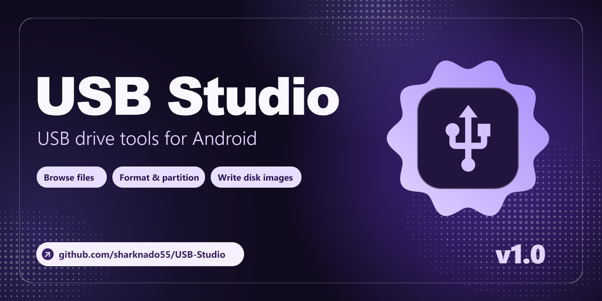

# USB Studio



Manage USB drives from an Android phone or tablet. Browse and copy files, format drives, edit partition tables, and write disk images over USB OTG.

**[Download the signed APK](https://github.com/sharknado55/USB-Studio/releases/latest/download/USB-Studio-1.0-signed.apk)** · [Release notes](https://github.com/sharknado55/USB-Studio/releases/latest)

## Install

1. Download the APK on a device running Android 7.0 or newer, then open it.
2. If Android prompts you, allow APK installation from the app you used to open the file.
3. Connect a USB mass-storage drive using an OTG adapter or USB-C cable, then grant USB access when prompted.

If you installed a development build signed with a different key, uninstall it before installing the release APK. Uninstalling removes its local app data and saved permissions.

## What you can do

- **Browse and manage files.** Grant folder access through Android’s Storage Access Framework to copy, rename, and delete files. Direct USB browsing is available for FAT32 in read-only mode.
- **Format and partition.** Create or edit MBR or GPT partition tables on drives that support direct USB block access.
- **Write disk images.** Select a local `.iso` or `.img` file and write it to a compatible USB drive.

> [!WARNING]
> Formatting, partition changes, and image writing can erase data. Back up the drive and verify the selected target before starting.

## Build and test

Use JDK 21 for the Android 16 Robolectric tests and install Android SDK Platform 36.1 and Build Tools 36.0.0. Open the project in Android Studio or set `ANDROID_HOME` to the SDK location. From the project root on Windows, run:

```powershell
.\gradlew.bat :app:assembleDebug :app:testDebugUnitTest :app:lintRelease
```

On macOS or Linux, use `sh ./gradlew` in place of `.\gradlew.bat`.

## Build release artifacts

Use Android Studio’s **Generate Signed App Bundle or APK** wizard or set `KEYSTORE_PATH`, `STORE_PASSWORD`, and `KEY_PASSWORD` in your local environment. The Gradle build expects a key alias of `upload` and defaults to `my-upload-key.jks` in the project root when only the passwords are set. For an existing Play listing, use its registered upload key and increase `versionCode` before submitting.

```powershell
.\gradlew.bat :app:assembleRelease :app:bundleRelease
```

Gradle writes the APK to `app/build/outputs/apk/release/` and the AAB to `app/build/outputs/bundle/release/`. Build with the release key to distribute an installable APK.

Before distribution, verify USB attach and permissions, file reads and writes, partitioning, formatting, and image writing on a physical Android device with a spare USB drive. Formatting, partition changes, and image writing can erase data.
